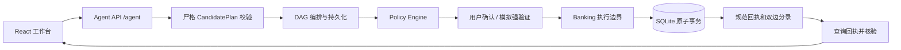

# 技术架构与实现说明

## 部署结构

首版采用模块化单体：一个 FastAPI 进程对外监听 8000，同时托管 React 构建文件。Agent、Banking、Policy 各自维护独立模块和 API 命名空间。Policy 的规则与资金约束是独立纯函数，不导入数据库或模型客户端。模块分离便于后续拆服务，本版没有宣称已部署微服务。

## 可信边界

模型和自然语言始终是不可信输入。模型只能返回 CandidatePlan，不能返回 approval、risk_level、status、receipt 或任意工具调用。工具是封闭的类型联合，不接受 shell/SQL/URL 作为执行工具。

A 保存结构合法且资源归属正确的候选计划。C 根据银行读取的真实日累计决定权限等级。B 在持有数据库写锁时再次判断，并根据已保存的计划校验版本、参数和幂等键。前端无法通过 approved=true 或修改 action 取得权限。

## 原子账务与幂等

每个写请求先执行 BEGIN IMMEDIATE，日累计查询、资金约束、审批消费和实际账务处于同一数据库写事务。付款同时生成付款方负分录与收款方正分录，借贷总和为零。余额应等于合成期初余额加流水和。

幂等键由 plan_id、version、step_id 唯一确定。数据库另外对 user+idempotency_key、plan+version+step 建唯一约束。相同请求返回原回执，换参数、版本或幂等键不能重放同一步骤。进程在提交前异常时事务回滚；提交后重试则查已有回执。

SQLite 的锁策略适用于此小规模演示。生产升级应改用数据库迁移、细粒度行锁、外部幂等服务及真实银行交易状态查询，不能直接复制这里的进程内调用假设。

## Financial Constraint Engine

可用金额 = 余额 - max(账户最低留存，本计划最低留存) - 全部有效未来承诺。

未来承诺包括已登记账单、订阅下一次扣款以及未执行的定时转账。取消订阅只释放仍有效的下一次承诺，重复取消返回安全无操作回执。当前不无限展开未来重复扣款，也不推断未登记的人生事件。

定时付款执行时排除该笔自身的预留，避免重复扣减，并在同一事务中将承诺标为 fulfilled。其余承诺保持有效。到期任务保留原计划最低留存要求，重新评估当日累计并请求新授权。

## 编排与恢复

计划文档、版本历史、审批和回执均在数据库持久化。DAG 按依赖就绪顺序执行，遇到授权门停止。重规划复用已核验完成且动作相同的步骤，并保留回执引用；其余步骤重新编号，新版本使旧审批失效。

暂停发生在执行请求之间或审批等待时。同步单事务执行期间不提供抢占中断，已经入账的交易不会通过“暂停”或“回滚计划”撤销。

## 模型适配

默认规则规划器支持已知收款人、明确阿拉伯数字金额、账单/余额查询、指定订阅取消、明天或 ISO 日期定时转账和最低留存。无法安全表达的条件、否定和歧义会要求澄清。

设置 PACT_OLLAMA_URL 和 PACT_OLLAMA_MODEL 后，适配器按 Ollama structured outputs 协议提交 CandidatePlan JSON Schema，解析后再次校验。失败直接报错，不自动降级为另一条可能不同的付款计划。已测试不合规模型返回的拒绝行为，未连测真实模型推理质量。

参考：[Ollama 结构化输出](https://docs.ollama.com/capabilities/structured-outputs)、[SQLite 事务](https://www.sqlite.org/lang_transaction.html)、[SQLAlchemy SQLite 方言](https://docs.sqlalchemy.org/en/20/dialects/sqlite.html)。
