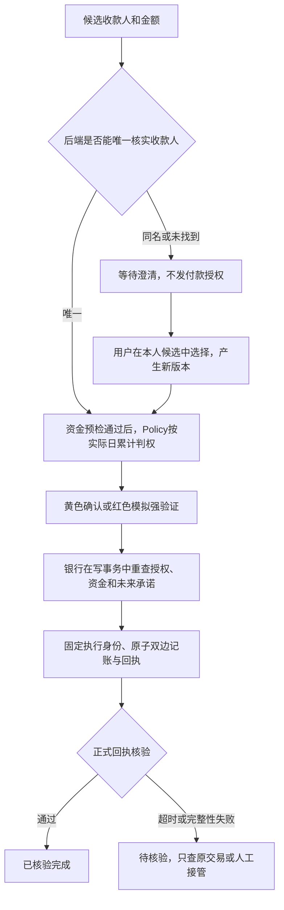
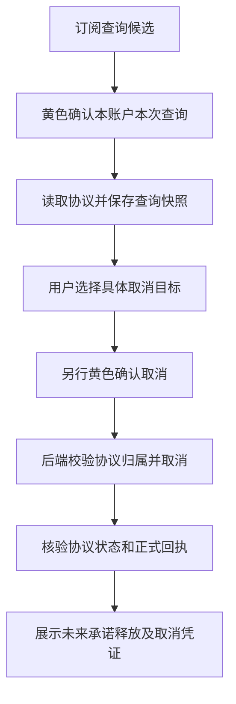

# 三个核心业务 DAG · 0.2 实现基线

依据：2026-10-24读取[本届官网](https://fintechathon.g-ican.com/)“国内赛道→赛题解析”完整内容。官方要求按业务拆解DAG、中断/回退/人工接管；并将订阅查询/取消列为黄色。下述图为PACT合成沙箱实现，不是微众内部生产业务图。

本次仅完善单项业务与通用执行安全状态。**既有跨场景请求的动作顺序、depends_on、就绪步骤选择方式均保持原样**。未引入DAG间优先级、全局排队、跨计划资源锁、冲突仲裁或新的跨场景调度策略。这些内容等待团队讨论确认。

## 智能转账

姓名查询必须经后端收款人名册解析。模型即使选出一个同名ID，也不能替代用户澄清。结构化调用可直接指定本人名册中明确的ID，最终付款仍需要确认。演示账户中的“王五”对应两个不同合成目标。

澄清选择绑定用户、计划版本、步骤、澄清编号、有效期与当时的候选集合；选择不等于付款授权。选择后旧审批失效，已核验步骤及其回执保留。审批另通过scope_hash绑定用户/计划版本/步骤/动作/最低留存。

本地银行写入异常会整体回滚；已经保存回执但核验超时/失败时转pending_verification，不能标成“付款失败”后重付。/run、/resume、/banking/execute不会重付该计划，/replan被拒绝。/reconcile仅查询原回执，不产生账务、不自动继续后续步骤。浏览器丢失执行响应时也提示先刷新原计划。

定时转账仍保持既有“登记承诺→到期新授权”行为，本次不修改定时与其他DAG的排序策略。余额不足或侵占已有承诺为明确失败，不能通过强验证越过资金约束。

## 账单分析

绿色查询。报告包含上海时间区间、收入/消费/转出分离统计、transaction_ids与异常提示。当前异常规则仅为非转账消费≥3000元；是待核查提示，不判断欺诈，不自动冻结/退款。原始备注属于数据，不能成为付款指令。时间范围支持本月/近30天。

## 订阅与代扣

查询与取消是不同授权，不以查询授权付款/取消。GET subscriptions没有receipt_id时返回403；携带查询回执时也只读取本人、本账户、确有已消费黄色确认的**原快照**，不授予后续实时查询权。旧版绿色查询回执不能作为黄色查询凭证。

绿色commitments/commitment-graph只展示订阅预留合计，不输出协议ID、商户名和单项扣款详情；内部资金约束仍计入完整预留。绿色流水可能显示历史消费备注，这是账单访问范围，不构成读取当前代扣协议的授权。

取消协议、商户退订、历史退款分别处理。本版只模拟取消代扣，拒绝夹带退款等未实现操作。取消与未来承诺释放在同一银行事务中完成；只释放尚未到期的对应承诺，已到期未核销义务保留。重复取消为安全无操作，不退回历史消费。

## 部分完成与人工接管

- 任一步明确失败且前序已有成功回执，计划为partially_completed；progress分别统计已核验、失败、待核验和剩余。不会撤销已发生交易，重新规划只处理剩余/新动作。
- 接管为当前账户持有人的本地人工处理演示，并非真实银行客服角色。handoff保存原因、主体、时间和原状态，立即作废旧审批并冻结自动执行。
- 接管期间仅允许读取/原交易核验；不能用run/resume/replan/execute绕过。release记录处理说明，交还至暂停、待核验或部分完成状态；不能提交“强制成功/已付款”等字段。恢复自动执行需重新授权。
- DAG本身不添加回边；澄清/重规划产生新版本，重试保持原执行身份，回退不等于逆向转账。

## 攻防验收入口

tests/test_business_boundaries.py覆盖：订阅直查/快照借用/跨用户与跨账户/绿色承诺侧路、未授权订阅名册进入模型、同名误选/篡改/过期/模型擅选、核验超时/传输错误/损坏回执、进程重启、旧审批重放、人工接管绕过/伪造成功、部分付款后重规划、恶意流水备注、取消失败/过期义务/退款混淆。

原有tests/test_workflows.py继续验证日累计阈值、并发幂等、原子回滚、资金约束、旧版本和注入防御；保留原跨场景顺序及依赖断言作为回归检查。运行证据见reports/tests.xml。
